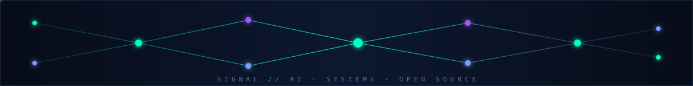

<p align="center">
  
</p>

<p align="center">
  
</p>

<table align="center">
<tr>
<td>

<pre>
╔══════════════════════════════════════════════════════════════════════╗
║  ● ● ●                  priyanshu@dev:~  —  zsh                     ║
╠══════════════════════════════════════════════════════════════════════╣
║                                                                    ║
║   $ cat about.md                                                   ║
║   name    : Priyanshu Kumar                                        ║
║   handle  : @priyanshkk                                            ║
║   role    : AI Engineer · Open-Source Developer                    ║
║   edu     : B.Tech CSE, Sandip University                          ║
║   loc     : India                                                  ║
║   focus   : Developer tools · AI/ML · DevOps · Privacy-first       ║
║   stack   : Python · TypeScript · React · FastAPI · Docker         ║
║   status  : online — building and shipping                         ║
║                                                                    ║
╚══════════════════════════════════════════════════════════════════════╝
</pre>

</td>
</tr>
</table>

<p align="center">
  
  
  
  
  
  
  
</p>

<p align="center">
  <a href="#about">About</a> · <a href="#now">Now</a> · <a href="#signal">Focus</a> · <a href="#portfolio">Portfolio</a> · <a href="#featured-projects">Projects</a> · <a href="#activity">Activity</a> · <a href="#contact">Contact</a>
</p>

---

## 🧠 About

I'm **Priyanshu Kumar** (`priyanshkk`), a **B.Tech CSE graduate** and **open-source developer from India** working as an **AI engineer and software developer**. I build **privacy-first developer tools, AI applications, CLI software and self-hosted/DevOps utilities** with **Python, TypeScript, Node.js, React, FastAPI, Docker and RAG pipelines**.

- 🔭 **Currently:** Building open-source tools such as `composeguard`, `envguard`, `workflowguard`, `runlog-lens`, `rag-audit`, `privacy-lens`, `status-sentinel`, `carbon-ledger`, `gitwhisper`, `finpulse-ai`, `contextkit` and `sathi-assistant`. Open to full-time roles and collaborations.
- 🌱 **Learning:** RAG systems, computer vision, typed APIs, Docker/self-hosted infrastructure and production-grade testing.
- 🤝 **Open to:** AI engineer, Python developer, TypeScript developer, backend/FastAPI, DevOps and open-source contributor roles.
- ⚡ **Fun fact:** Early riser who likes turning messy problems into simple command-line tools.

> Clean code, honest tests, zero telemetry and tools that work offline matter to me.

---

## 🛰️ Now

<p align="center">
  
  
  
  
</p>

- 🛠️ **Shipping:** `workflowguard` — offline GitHub Actions risk linter, `runlog-lens` — CI failure-cause and flaky-step analysis, `composeguard` — Docker Compose validator, `envguard` — `.env` validator, `rag-audit` — grounded RAG checks, `privacy-lens` — static tracker scans, `status-sentinel` — incident diffs, and `carbon-ledger` — cloud/AI emission estimates.
- 🔐 **Maintaining:** `gitwhisper` — privacy-first secret guard, clean commits and PR summaries.
- 📚 **Learning:** RAG systems, OWL-ViT computer vision and production-grade testing.
- 🤝 **Open for:** collaborations on practical AI apps and developer tooling.

---

## 📡 Signal — what I build

| Area | What that means |
| :--- | :--- |
| 🧠 **AI Systems** | Local-first assistants, RAG pipelines, open-vocabulary detection and explainable memory. |
| ⌨️ **Developer Tools** | Offline CLIs, GitHub Actions auditing, `.env` and Compose validators, and libraries with typed APIs and real test coverage. |
| 🐳 **Self-Hosted / DevOps** | Workflow risk checks, Docker Compose auditing, privacy-first services and one-command deployments. |
| 🔐 **Security** | Secret detection, supply-chain pinning, CI injection and pwn-request checks, path-traversal defence and safe file handling. |

<p align="center">
  
</p>

---

## 🌐 Portfolio

**[priyanshkk.github.io](https://priyanshkk.github.io)** — a fully animated, responsive portfolio built with plain HTML, CSS and vanilla JavaScript. No frameworks, no trackers.

---

## 🚀 Featured projects

| Repository | ⭐ | What it does |
| :--- | :---: | :--- |
| [**composeguard**](https://github.com/priyanshkk/composeguard) | [](https://github.com/priyanshkk/composeguard/stargazers) | Offline Docker Compose validator and deployment-readiness auditor for homelabs and CI. 12 rules, JSON output, zero telemetry. |
| [**workflowguard**](https://github.com/priyanshkk/workflowguard) | [](https://github.com/priyanshkk/workflowguard/stargazers) | Offline GitHub Actions linter for supply-chain pins, token scope, shell injection, pwn-request and CI cost. 12 rules, JSON output, browser checker. |
| [**envguard**](https://github.com/priyanshkk/envguard) | [](https://github.com/priyanshkk/envguard/stargazers) | Offline `.env` validator that catches example drift, bad values and undocumented source usage. 10 rules, JSON output, browser checker. |
| [**gitwhisper**](https://github.com/priyanshkk/gitwhisper) | [](https://github.com/priyanshkk/gitwhisper/stargazers) | Privacy-first AI CLI that catches leaked secrets, writes clean commits and generates PR summaries. Local dashboard, offline fallback. |
| [**finpulse-ai**](https://github.com/priyanshkk/finpulse-ai) | [](https://github.com/priyanshkk/finpulse-ai/stargazers) | Self-hosted invoice and expense tracker with an AI receipt scanner, offline fallback and one-command Docker setup. |
| [**sathi-vision**](https://github.com/priyanshkk/sathi-vision) | [](https://github.com/priyanshkk/sathi-vision/stargazers) | Live browser-camera object detection with Python, FastAPI, OpenCV and OWL-ViT open-vocabulary AI. |
| [**sathi-assistant**](https://github.com/priyanshkk/sathi-assistant) | [](https://github.com/priyanshkk/sathi-assistant/stargazers) | Local-first voice assistant with explainable memory, habits, focus tracking and a decision compass. No API key required. |
| [**contextkit**](https://github.com/priyanshkk/contextkit) | [](https://github.com/priyanshkk/contextkit/stargazers) | Token-aware, structure-preserving text chunking for RAG pipelines with a typed API and CLI. Zero runtime dependencies. |
| [**rag-audit**](https://github.com/priyanshkk/rag-audit) | [](https://github.com/priyanshkk/rag-audit/stargazers) | Offline RAG audit that checks citation validity, groundedness and context utilization with CI-friendly thresholds. JSON and Markdown reports, zero dependencies. |
| [**privacy-lens**](https://github.com/priyanshkk/privacy-lens) | [](https://github.com/priyanshkk/privacy-lens/stargazers) | Static HTML privacy scanner for trackers, third-party scripts, iframes, forms and fingerprinting signals. No network calls, no JavaScript execution. |
| [**status-sentinel**](https://github.com/priyanshkk/status-sentinel) | [](https://github.com/priyanshkk/status-sentinel/stargazers) | Statuspage incident diff tool that detects new, escalating, regressing and resolved incidents from local snapshots or a polled feed. |
| [**carbon-ledger**](https://github.com/priyanshkk/carbon-ledger) | [](https://github.com/priyanshkk/carbon-ledger/stargazers) | Estimates electricity use, CO2e and optional running cost for cloud and AI workloads from a simple CSV, with region overrides and CI thresholds. |
| [**runlog-lens**](https://github.com/priyanshkk/runlog-lens) | [](https://github.com/priyanshkk/runlog-lens/stargazers) | Offline CI run-log analyzer that labels failure causes, catches flaky retries and flags slow steps with auditable Markdown or JSON reports. |
| [**safepath**](https://github.com/priyanshkk/safepath) | [](https://github.com/priyanshkk/safepath/stargazers) | Dependency-free path-traversal defence for Python file-serving apps, with a CLI and 56 tests. |
| [**file-organizer**](https://github.com/priyanshkk/file-organizer) | [](https://github.com/priyanshkk/file-organizer/stargazers) | Organise files into categories with a dry-run mode and one-command undo. |
| [**snake-game**](https://github.com/priyanshkk/snake-game) | [](https://github.com/priyanshkk/snake-game/stargazers) | Classic Snake in Python with pygame and unit-tested game logic. |

Also in the toolbox: [weather-cli](https://github.com/priyanshkk/weather-cli) · [expense-tracker](https://github.com/priyanshkk/expense-tracker) · [password-toolkit](https://github.com/priyanshkk/password-toolkit)

⭐ Star a repo if it helps you — it genuinely keeps the builds going.

---

## 🛠️ Tech stack

<p align="center">
  
  <br/>
  
</p>

---

## 📊 Activity

<p align="center">
  
  
</p>

<p align="center">
  
</p>

<p align="center">
  
</p>

<p align="center">
  
</p>

<p align="center">
  
</p>

<p align="center">
  
</p>

<p align="center">
  
</p>

---

## 📫 Contact

Best way to reach me: **priyanshukumarpk3645736@gmail.com**

<p align="center">
  <a href="https://www.linkedin.com/in/priyanshu-kumar-a195ba271/"></a>
  <a href="https://x.com/Priyanshu_kk_29"></a>
  <a href="https://www.instagram.com/priyanshu.k_/"></a>
  <a href="https://www.facebook.com/priyanshu.kk.3"></a>
  <a href="https://www.youtube.com/@priyanshu.kk.3"></a>
  <a href="https://youtube.com/@ApexViewYT"></a>
  <a href="mailto:priyanshukumarpk3645736@gmail.com"></a>
</p>

```bash
$ exit
> "Keep learning · Keep building · Keep growing"
[Process completed with exit code 0]
```

<p align="center">
  
</p>

<p align="center">
  
</p>
