<p align="center">
  
</p>

<p align="center">
  
</p>

<table align="center">
<tr>
<td>

<pre>
╔══════════════════════════════════════════════════════════════════════╗
║  ● ● ●                  priyanshu@dev:~  —  zsh                     ║
╠══════════════════════════════════════════════════════════════════════╣
║                                                                    ║
║   $ cat about.md                                                   ║
║   name    : Priyanshu Kumar                                        ║
║   role    : B.Tech CSE graduate · Software Engineer                 ║
║   edu     : Sandip University                                       ║
║   loc     : India                                                   ║
║   focus   : Developer tools · AI/ML · Privacy-first software        ║
║   stack   : Python · TypeScript · React · Node.js · Docker          ║
║   status  : online — building and shipping                          ║
║                                                                    ║
╚══════════════════════════════════════════════════════════════════════╝
</pre>

</td>
</tr>
</table>

<p align="center">
  
  
  
  
  
  
  
</p>

<p align="center">
  <a href="#about">About</a> · <a href="#now">Now</a> · <a href="#portfolio">Portfolio</a> · <a href="#featured-projects">Projects</a> · <a href="#tech-stack">Stack</a> · <a href="#github-activity">Activity</a> · <a href="#contact">Contact</a>
</p>

<p align="center">
  
</p>

---

## 🧠 About

- 🔭 **Currently:** B.Tech CSE graduate building privacy-first developer tools and AI-powered applications. Open to full-time roles and collaborations.
- 🌱 **Learning:** TypeScript, React, RAG pipelines, and production-grade testing.
- 🤝 **Open to:** Collaborations on open-source CLI tools, AI utilities, and practical hackathon projects.
- ⚡ **Fun fact:** Early riser who likes turning messy problems into simple command-line tools.

> Clean code, honest tests, and tools that work offline matter to me.

---

## 🧭 Now

<p align="center">
  
  
  
  
</p>

- 🛠️ **Shipping:** `gitwhisper` — privacy-first secret guard, clean commits and PR summaries.
- 📚 **Learning:** RAG systems, typed APIs and production-grade testing.
- 🤝 **Open for:** collaborations on open-source developer tools and practical AI apps.

---

## 🌐 Portfolio

**[priyanshkk.github.io](https://priyanshkk.github.io)** — a fully animated, responsive portfolio built with plain HTML, CSS and vanilla JavaScript. No frameworks, no trackers.

---

## 🚀 Featured projects

| Repository | What it does |
| :--- | :--- |
| [**gitwhisper**](https://github.com/priyanshkk/gitwhisper) | Privacy-first AI CLI that catches leaked secrets, writes clean commits and generates PR summaries. Local dashboard, offline fallback, no API key needed for the demo. |
| [**finpulse-ai**](https://github.com/priyanshkk/finpulse-ai) | Self-hosted invoice and expense tracker with an AI receipt scanner, offline fallback and one-command Docker setup. |
| [**contextkit**](https://github.com/priyanshkk/contextkit) | Token-aware, structure-preserving text chunking for RAG pipelines with a typed API and CLI. Zero runtime dependencies. |
| [**safepath**](https://github.com/priyanshkk/safepath) | Dependency-free path-traversal defence for Python file-serving apps, with a CLI and 56 tests. |
| [**file-organizer**](https://github.com/priyanshkk/file-organizer) | Organise files into categories with a dry-run mode and one-command undo. |
| [**snake-game**](https://github.com/priyanshkk/snake-game) | Classic Snake in Python with pygame and unit-tested game logic. |

Also in the toolbox: [weather-cli](https://github.com/priyanshkk/weather-cli) · [expense-tracker](https://github.com/priyanshkk/expense-tracker) · [password-toolkit](https://github.com/priyanshkk/password-toolkit)

⭐ Star a repo if it helps you — it genuinely keeps the builds going.

---

## 🛠️ Tech stack

<p align="center">
  
  <br/>
  
</p>

---

## 📊 GitHub activity

<p align="center">
  
  
</p>

<p align="center">
  
</p>

<p align="center">
  
</p>

<p align="center">
  
</p>

<p align="center">
  
</p>

<p align="center">
  
</p>

---

## 📫 Contact

Best way to reach me: **priyanshukumarpk3645736@gmail.com**

<p align="center">
  <a href="https://linkedin.com/in/priyanshu-kumar-35a03137a"></a>
  <a href="https://x.com/Priyanshu_kk_29"></a>
  <a href="https://instagram.com/priyanshu.k_"></a>
  <a href="https://youtube.com/@ApexViewYT"></a>
  <a href="mailto:priyanshukumarpk3645736@gmail.com"></a>
</p>

```bash
$ exit
> "Keep learning · Keep building · Keep growing"
[Process completed with exit code 0]
```

<p align="center">
  
</p>

<p align="center">
  
</p>
